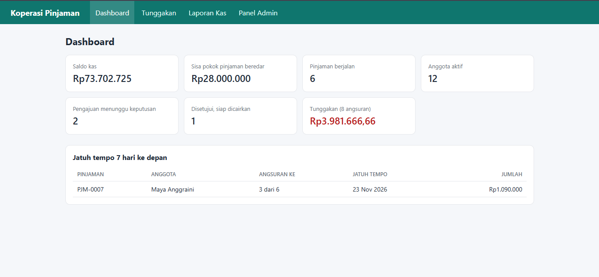
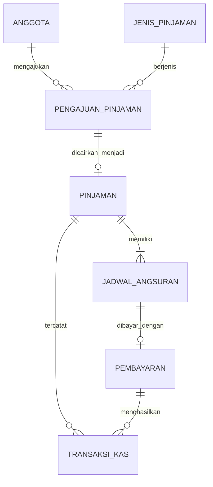
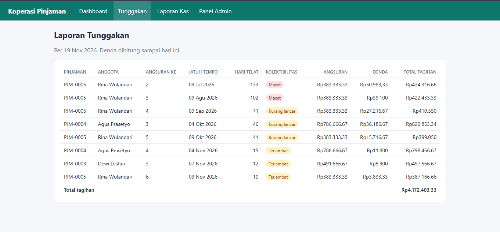
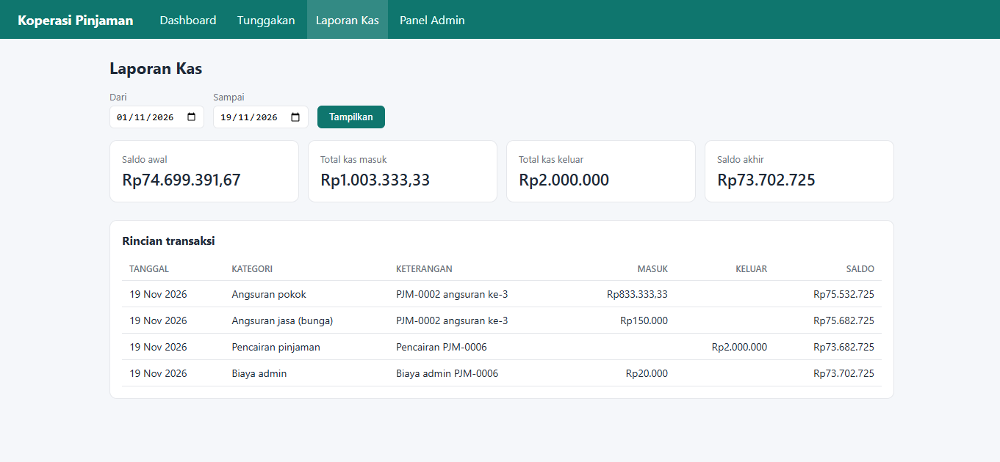
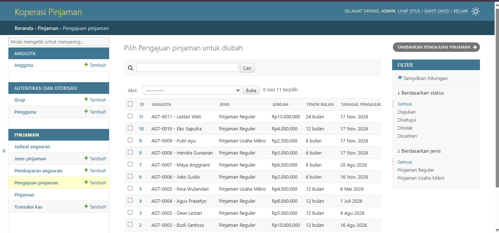

# Koperasi Pinjaman

Aplikasi web untuk mengelola pinjaman koperasi: pengajuan, persetujuan, pencairan, jadwal angsuran,
pembayaran dengan denda otomatis, buku kas, dan laporan. Dibuat sebagai proyek portfolio.

> Semua data di aplikasi ini fiktif.



## Fitur

- **Peran dan hak akses:** Kasir, Pengurus, dan Admin dengan wewenang berbeda (pemisahan tugas)
- **Alur pinjaman:** Pengajuan, Disetujui/Ditolak, Dicairkan, Lunas
- **Jadwal angsuran otomatis** (bunga flat) dengan penanganan sisa pembulatan
- **Pembayaran angsuran** berurutan, denda keterlambatan otomatis, dan status lunas otomatis
- **Buku kas** yang hanya bisa bertambah (koreksi lewat transaksi baru), dengan saldo berjalan
- **Dashboard dan laporan:** saldo kas, sisa pokok, tunggakan dengan tingkat kolektibilitas, kas per periode
- **Data contoh** otomatis dengan satu perintah
- **21 automated test** untuk perhitungan, alur pembayaran, hak akses, dan halaman laporan

## Peran

| Peran    | Boleh                                                                             | Tidak boleh                              |
| -------- | --------------------------------------------------------------------------------- | ---------------------------------------- |
| Kasir    | Input anggota dan pengajuan, mencairkan pinjaman, mencatat pembayaran, kas manual | Menyetujui pengajuan                     |
| Pengurus | Menyetujui atau menolak pengajuan, melihat laporan                                | Mencairkan, mencatat pembayaran          |
| Admin    | Mengatur sistem dan pengguna                                                      | (tidak dipakai untuk operasional harian) |

Alur: **Kasir input pengajuan, Pengurus menyetujui, Kasir mencairkan, Kasir mencatat pembayaran.**

## Aturan bisnis (contoh, bisa diatur di Jenis Pinjaman)

- Bunga flat 1,5% per bulan dari pokok awal, tenor 6/12/24 bulan
- Biaya admin 1% dipotong dari pencairan
- Denda 0,1% dari angsuran per hari keterlambatan
- Kolektibilitas: Lancar, Terlambat (1-30 hari), Kurang lancar (31-90), Macet (>90)

Contoh: pinjaman Rp6.000.000, 12 bulan, bunga flat 1,5%/bulan, angsuran = Rp500.000 + Rp90.000 = Rp590.000/bulan.

## Keputusan desain

- Uang disimpan sebagai `DECIMAL`, bukan float
- Pembayaran dan perubahan kas dalam satu **database transaction** (semua berhasil atau semua batal)
- Pembayaran ganda dicegah di level database (`OneToOneField`) dan di level aplikasi
- Aturan bunga/denda **disalin ke pinjaman** saat pencairan, sehingga perubahan aturan tidak mengubah pinjaman lama
- Kas, pembayaran, dan jadwal tidak bisa diedit atau dihapus lewat aplikasi (bisa diaudit)
- Logika perhitungan dipisah ke `services.py` agar mudah dites

## ERD



## Teknologi

Python, Django, SQLite, HTML/CSS (tanpa framework tambahan).

## Menjalankan di komputer sendiri (Windows PowerShell)

```
git clone [URL repo ini]
cd koperasi-pinjaman
python -m venv venv
venv\Scripts\Activate.ps1
pip install -r requirements.txt
python manage.py migrate
python manage.py createsuperuser
python manage.py buat_data_contoh
python manage.py runserver
```

Buka http://127.0.0.1:8000. Akun demo (hanya untuk uji coba): user `kasir` dan `pengurus`, password `demo12345`.

Menjalankan test:`python manage.py test`

## Tampilan





## Rencana pengembangan

- Peran **Kolektor** (per resort) dan **Pengawas** yang memeriksa setoran kolektor
- Pembayaran harian dan mingguan, selain bulanan
- Pembayaran sebagian dan pembatalan pembayaran (koreksi)
- Modul simpanan dan SHU

## Pembuat

[Penni Wintasari Simarmata] - [penniwitasari1122@gmail.com]
